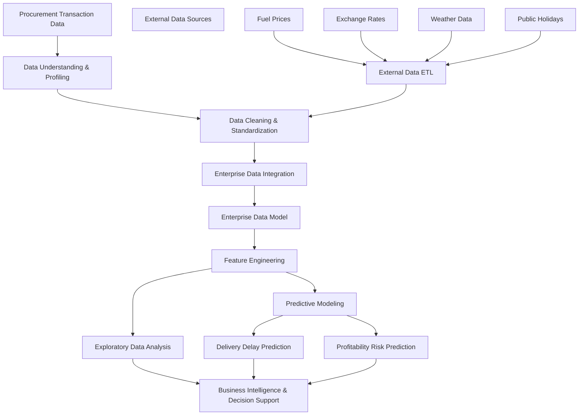

# SupplySight AI

### Enterprise Procurement Decision Intelligence Platform

\<p align="center">
&#x20; \<strong>Transforming procurement data into actionable business intelligence through data engineering, advanced analytics, and machine learning.\</strong>
\</p>

\<p align="center">
&#x20; \
&#x20; \
&#x20; \
&#x20; \
&#x20; \
&#x20; \
\</p>

---

## Overview

**SupplySight AI** is an enterprise procurement analytics and predictive intelligence project designed to transform fragmented supply chain and procurement data into a structured, analytics-ready decision-support ecosystem.

The platform integrates procurement transaction data with external business and environmental intelligence, including fuel prices, foreign exchange rates, weather conditions, and public holidays.

Through a structured data engineering and analytics pipeline, the project aims to uncover procurement inefficiencies, understand profitability drivers, identify delivery risks, and support data-driven operational decisions.

Rather than treating data cleaning, analysis, and machine learning as isolated activities, SupplySight AI follows an end-to-end analytical workflow — from external data acquisition and enterprise data integration to predictive modeling.

## Business Problem

Procurement and supply chain operations are influenced by multiple interconnected factors:

- Fluctuating fuel and commodity costs.
- Foreign exchange rate variations across countries.
- Weather conditions and regional disruptions.
- Public holidays and calendar-related operational constraints.
- Delivery delays and fulfillment inefficiencies.
- Differences in order profitability and operational performance.

Analyzing procurement transactions in isolation can hide these relationships and limit the ability to identify operational risks.

**SupplySight AI addresses this challenge by combining internal procurement data with external intelligence to create a unified foundation for enterprise analytics and predictive decision-making.**

## Project at a Glance

| Dimension                          | Project Scope                        |
| ---------------------------------- | ------------------------------------ |
| Domain                             | Procurement & Supply Chain Analytics |
| Procurement Transactions           | 180,519                              |
| Standardized Analytical Attributes | 146                                  |
| Geographic Coverage                | 164 Countries                        |
| Data Engineering                   | ETL, Cleaning & Integration          |
| Data Modeling                      | Enterprise Dimensional Modeling      |
| Analytics                          | EDA & Feature Engineering            |
| Predictive Analytics               | Delivery Delay & Profitability Risk  |
| Development Environment            | Python & Jupyter Notebook            |

## Key Capabilities

### 1. External Data Acquisition & ETL

Developed data acquisition workflows to enrich procurement transactions with external intelligence.

- Fuel price data acquisition.
- Public holiday data extraction.
- Weather data acquisition.
- Foreign exchange rate extraction.
- Enterprise country dimension development.
- Country-level weather and holiday integration.

### 2. Data Understanding & Enterprise Modeling

Established a structured foundation for enterprise-level analytics.

- Procurement data profiling and understanding.
- Enterprise data modeling.
- Dimensional modeling using a Kimball-oriented approach.
- Country-level data standardization.
- Preparation of integrated analytical datasets.

### 3. Data Cleaning & Enterprise Integration

Transformed heterogeneous datasets into a consistent analytical structure.

- Data quality assessment and validation.
- Missing value and inconsistency handling.
- Standardization of external datasets.
- Integration of procurement and external intelligence.
- Analytical readiness validation.

### 4. Feature Engineering & Exploratory Analytics

Developed analytical features to capture business and operational relationships.

- Enterprise feature engineering.
- Feature store preparation.
- Exploratory data analysis.
- Analysis of procurement, delivery, and profitability patterns.
- Preparation of model-ready analytical features.

### 5. Predictive Analytics & Machine Learning

Developed predictive modeling workflows focused on two important business problems:

**Delivery Delay Prediction**

- Identify patterns associated with delivery delays.
- Analyze operational and external factors influencing delivery performance.
- Develop a predictive modeling workflow for delivery delay risk.

**Profitability Risk Prediction**

- Investigate factors associated with negative profitability.
- Analyze relationships between procurement characteristics and profitability.
- Develop a predictive modeling workflow for profitability risk.

## End-to-End Architecture

The project follows a modular data engineering and analytics architecture:



## Technology Stack

| Category              | Technologies                                   |
| --------------------- | ---------------------------------------------- |
| Programming           | Python                                         |
| Data Manipulation     | Pandas, NumPy                                  |
| Data Acquisition      | Requests, REST APIs                            |
| Data Engineering      | ETL, Data Cleaning, Data Integration           |
| Data Modeling         | Enterprise Dimensional Modeling                |
| Analytics             | Exploratory Data Analysis, Feature Engineering |
| Machine Learning      | Scikit-learn                                   |
| Development           | Jupyter Notebook                               |
| Business Intelligence | Power BI (presentation layer)                  |

## Repository Structure

```text
SupplySight-AI/
│
├── Notebooks/
│   ├── 01A_External_Data_ETL-fetch_fuel_prices.ipynb
│   ├── 01B_External_Data_ETL-fetch_holidays.ipynb
│   ├── 01C_External_Data_ETL-fetch_weather.ipynb
│   ├── 01D_External_Data_ETL_fetch_exchange_rates.ipynb
│   ├── 01E_Build_Enterprise_Country_Dimension.ipynb
│   ├── 01F_Country_Weather_ETL.ipynb
│   ├── 01G_Country_Holiday_ETL.ipynb
│   │
│   ├── 02A_Data_Understanding.ipynb
│   ├── 02B_Enterprise_Data_Modeling.ipynb
│   │
│   ├── 03A_DataCo_Data_Cleaning_&_Transformation.ipynb
│   ├── 03B_External_Data_Cleaning_&_Standardization.ipynb
│   │
│   ├── 04A_Enterprise_Data_Integration.ipynb
│   ├── 04B_Enterprise_Data_Validation_&_Analytical_Readiness.ipynb
│   │
│   ├── 05A_Enterprise_Feature_Engineering.ipynb
│   ├── 05B_Enterprise_Feature_Store_EDA.ipynb
│   │
│   ├── 06A _Advanced_Analytics_Preparation_&_Target_Engineering.ipynb
│   ├── 06B_Delivery_Delay_Prediction.ipynb
│   └── 06C_Profitability_-Risk_Prediction.ipynb
│
├── Dashboard/
│
├── Scripts/
│
├── Datasets/                 # Excluded from public repository
│
├── .env.example
├── .gitignore
├── README.md
└── requirements.txt
```

## Getting Started

### 1. Clone the Repository

```bash
git clone https://github.com/chavijain332/SupplySight-AI.git
cd SupplySight-AI
```

### 2. Create a Virtual Environment

```bash
python -m venv .venv
```

Activate it on Windows:

```powershell
.venv\Scripts\Activate.ps1
```

### 3. Install Dependencies

```bash
pip install -r requirements.txt
```

Install the additional notebook libraries if they are not already included in `requirements.txt`:

```bash
pip install jupyter pandas numpy matplotlib seaborn scikit-learn requests python-dotenv
```

### 4. Configure Environment Variables

Create a local `.env` file using the provided template:

```powershell
Copy-Item .env.example .env
```

Add your own API credentials to `.env`:

```env
FUEL_API_KEY=your_api_key_here
```

**Security:** Never commit `.env` or expose API credentials in notebooks, outputs, or source code.

### 5. Launch Jupyter Notebook

```bash
jupyter notebook
```

Open the notebooks in numerical sequence, beginning with the external data acquisition workflows.

**Data availability:** The datasets and generated modeling artifacts are excluded from this public repository. Provide the required source datasets and configure the relevant API credentials locally before executing the corresponding notebooks.

## Business Value

SupplySight AI demonstrates how enterprise data engineering and predictive analytics can contribute to better procurement and supply chain decisions.

The intended business outcomes include:

- **Improved visibility:** Integrating procurement transactions with external intelligence.
- **Better operational insights:** Understanding factors associated with delivery performance.
- **Risk identification:** Developing predictive signals for delivery delays and negative profitability.
- **Data consistency:** Establishing standardized, validated, analytics-ready datasets.
- **Scalable analytics:** Creating a modular foundation for future reporting and decision-support capabilities.

## Project Status

**Development in progress.**

The repository currently contains the core data acquisition, data preparation, enterprise integration, feature engineering, exploratory analytics, and predictive modeling notebooks.

Dashboard implementation, further model evaluation, and additional decision-support enhancements can be incorporated as the project evolves.

## Future Enhancements

- Interactive procurement performance dashboards.
- Model performance comparison and hyperparameter optimization.
- Explainable machine learning for identifying key risk drivers.
- Automated data pipeline execution and monitoring.
- Deployment of predictive insights through an interactive application.

## Author

**Chavi Jain**

Aspiring Data Analyst | Business Analytics | Data Engineering | Predictive Analytics

Interested in building data-driven solutions that connect engineering, analytics, and business decision-making.

- **GitHub:** [@chavijain332](https://github.com/chavijain332)
- **Project Repository:** [SupplySight AI](https://github.com/chavijain332/SupplySight-AI)

---

\<p align="center">   \<strong>SupplySight AI — Turning Procurement Data into Predictive Business Intelligence.\</strong> \</p>
